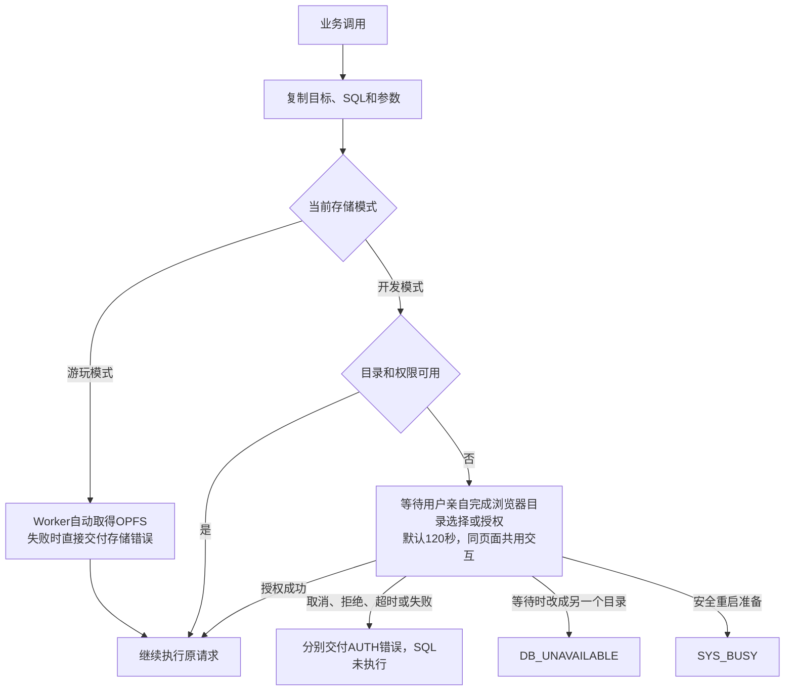

# 公共接口契约

本文说明业务脚本怎样取得入口和固定代理、防抖配置的含义，以及未授权时的调用会怎样等待。方法与参数规则见[数据库与保存契约](数据库与保存契约.md)，错误字段与处理见[错误说明](../指南/错误说明.md)，完整例子见[业务侧使用指南](../指南/业务侧使用指南.md)。

## 获取入口与代理

业务先 `await waitGlobalInitialized('SqliteHelper')`，再读全局变量 `SqliteHelper`，不使用等待函数的返回值。入口由前端扩展通过酒馆助手发布，不要求目录已经授权；无需 import 运行时 SDK，也不调用 connect 或 getHandles。

| 入口 | 返回 |
| --- | --- |
| `SqliteHelper.root` | 当前存储配置的全局代理 |
| `SqliteHelper.char` | 当前角色的代理；没有有效角色时为 null |
| `SqliteHelper.chat` | 当前单人聊天的代理；没有有效单人聊天时为 null |

每次访问返回独立代理，同页面仍共享连接、调度服务与同一 Worker，包含 DVS、角色卡 iframe 和多个配置面板。属性访问同步捕获当时的角色、聊天和已知目录配置，不读写服务器编号、不建库；方法内才异步核对原对象。未保存的聊天必须仍是原对象、引用未变才能初始化，不能从旧消息快照重建历史文件。首次写入与缺失文件的处理见[数据库与保存契约](数据库与保存契约.md#数据范围和文件)。

例如在聊天 A 取得 `chatA` 后切到 B，`chatA` 仍操作 A，重新读取 `SqliteHelper.chat` 才取得 B。长期持有、解构、防抖或等待授权都不会让原代理跟随当前聊天；目录配置变化则拒绝旧代理，不转写新目录。

## 公开操作与防抖

公共代理只提供 `debounce`、`query`、`update`、`exec`、`transaction` 和 `runSql`。flush、refresh、checked-transaction、目录管理、连接销毁和重启属于插件内部，完整公共类型使用扩展包中的 `types/sqlite-helper.d.ts`。没有公共同步保存选项或保存订阅。

新代理按主页面实际运行模式取得默认写入防抖：SharedWorker 为 3000ms，普通 Worker 为 100ms。业务脚本不自行检测宿主，也不创建 Worker。`debounce` 接受 `false` 或有限非负数，最大 2147483647；`false` 和 0 关闭后续写入防抖，正数指定毫秒。它返回代理自身，只影响后来接收的写入，已接收调用保留原配置，query 不防抖。

例如保存 `const chat = SqliteHelper.chat` 后调用 `chat.debounce(1000)`，只影响这个代理；再次读取属性得到的新代理仍用默认值。底层同目标队列共享，代理配置独立。

页面防抖收集全部修改，不只留最后一次。每个写入调用仍有独立事务和返回结果，防抖只改变何时发送。需要共同成功或失败的命令放同一次 `transaction`；需要 AI 结果基于先前 UI 修改时，先等待相关写入 Promise 成功再提交，这个等待只证明内存提交，不证明文件已保存。文件保存的等待和合并规则见[数据库与保存契约](数据库与保存契约.md#事务和保存)，调用顺序见[调用等待与恢复契约](调用等待与恢复契约.md)。

## 未授权时的调用

query 和写入先复制原目标、SQL 和参数，再确认连接、版本和当前存储条件。授权等待不占数据库执行队列，也不提前启动防抖。

图的读法：游玩模式没有授权等待；开发模式只有目录或权限缺失才等待，结束的调用不会因迟到授权再次执行。

补充规则：

- 未知配置先恢复和查询；开发模式确实从未配置目录时允许首次绑定一次，已有配置只能恢复原权限。
- 改用游玩模式会结束原目录授权等待；聊天切换不改变原对象。
- 安全重启准备结束仍在授权等待的调用，已开始的身份和数据库工作仍等待结束。
- 内部查看不走能够首次绑定目录的业务授权等待，只读取已有身份和数据库。

## 故障与结果交付

公共写入成功返回 `{ committed: true, persisted: false }`，证明当前内存实例完成本次 SQL 提交，后续查询可以读到结果；这个结果的含义和文件保存规则见[数据库与保存契约](数据库与保存契约.md#事务和保存)。

失败通过 Promise 拒绝，同步的属性或配置错误使用同一公共格式，不要求跨 iframe 的 Error 类身份一致。字段含义、完整 code 与处理见[错误说明](../指南/错误说明.md)。例如笔记已在内存提交但调用另有错误，报 `SQL_COMMITTED`，业务不应重复提交；已发送后丢失响应，报 `SQL_UNKNOWN`，应保留输入并停止依赖它的流程。后台保存失败由插件独立提示，不改变原 Promise 和内存成功日志。不能把编号保存、管理保存或另一笔结果归给这次 SQL。

写入方法不接收 options，成功结果不含 operationId。JavaScript 传旧 options 明确报错，再次提交是新调用。配套版本不兼容时拒绝，更新操作见[使用与维护指南](../指南/使用与维护指南.md#安装与更新)。
