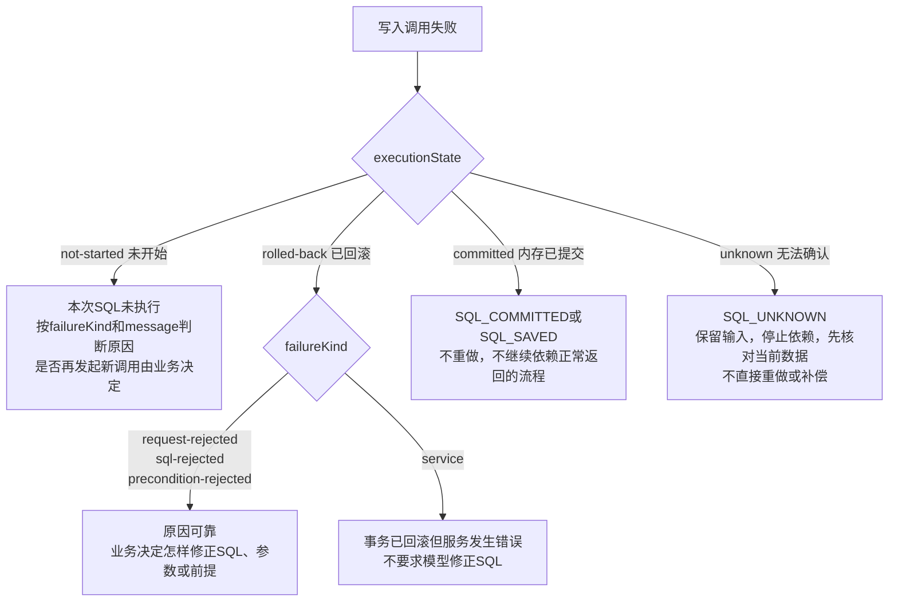

# 错误说明

本文区分业务拿到的公共错误与框架内部用于恢复、定位的详细错误。业务使用错误顶层的 `failureKind`、`executionState`、`code`、`message`、`level` 和可选 `suggestion`，`data` 只供调试，不要求业务解析编号、通信和内部阶段。

## 业务拿到的公共错误

例如插入一条笔记，正常返回 `{ committed: true, persisted: false }` 后，后续查询可以读到它，但本次调用没有交付文件保存确认。若内存提交之后另有调用错误，收到 `SQL_COMMITTED`；若已发送写入的响应丢失，收到 `SQL_UNKNOWN`，不能直接再插入一条。角色编号已保存、后台文件已保存和本次 SQL 是否提交分别判断。

公共声明导出 `PublicError`、`FailureKind`、`ExecutionState` 及对应字段类型。业务可直接按失败原因及执行结果处理，内部 ErrorCode 和诊断 data 不作为普通业务分支。业务使用以下字段：

| 字段 | 用途 |
| --- | --- |
| failureKind | request-rejected 表示 SQL 方法边界、参数或命令格式拒绝；sql-rejected 表示可靠 SQLite 结果证明 SQL／约束拒绝；precondition-rejected 表示事务内业务前提或影响行数检查不通过；service 表示服务、文件、运行时或无法可靠归类的原因 |
| executionState | 写入为 not-started（未开始）、rolled-back（已确认回滚）、committed（内存已提交）或 unknown（无法确认）；查询不带此字段。它只描述本次业务 SQL，不描述编号或管理保存 |
| code | 按AUTH_、SQL_、COM_、SYS_、DB_分类的稳定短名称，需要不同业务动作的结果才分开 |
| message | 说明本次操作发生了什么、已确认影响及可行处理；不按code逐词翻译，也不要求用户理解编号或通信步骤 |
| level | info／warning／error，只选择提示方式，不判断SQL是否执行或保存 |
| suggestion | 可选abort_quiet／retry_later／refresh_page，只提供建议，不自动重试、刷新或返回成功 |
| data | 原内部错误、具体原因、结果证据和本调用关联信息，供调试；普通业务不解析它来决定业务流程 |

方法通过Promise拒绝交付错误；属性访问或debounce配置失败可能同步抛出同一公共格式。跨iframe或不同打包副本按字段读取，不依赖 `instanceof`。错误处理步骤见[业务指南](业务侧使用指南.md#错误处理)，可运行的完整处理见[笔记示例](../../../examples/helper-notes/README.md)。

### 公共code与处理

| code | 已知结果与处理 | level／可能的建议 |
| --- | --- | --- |
| AUTH_CANCELLED | 已取消本次目录授权，当前SQL未执行；结束本次流程，不自动再弹授权 | info／abort_quiet |
| AUTH_DENIED | 尚无所需目录权限，当前SQL未执行；按message恢复权限，不静默换目录 | warning |
| AUTH_TIMEOUT | 本次授权等待超时，当前SQL未执行；完成授权后再发起需要的操作，迟到授权不恢复旧调用 | warning |
| AUTH_FAILED | 目录选择或授权未能完成，当前SQL未执行；保留实际异常供诊断，不一概说用户拒绝权限 | warning |
| SQL_INVALID | SQL、参数或调用配置不符要求；executionState 区分执行前拒绝与事务内拒绝后回滚 | error |
| SQL_FAILED | 查询没有返回结果，或 SQL／事务内检查拒绝了修改；按 failureKind 和 executionState 判断原因及结果 | error |
| SQL_COMMITTED | 本次 SQL 已在内存提交，调用另有错误；不重复提交，不按普通成功继续依赖返回结果的流程；无文件保存确认 | error |
| SQL_SAVED | 本次修改已确认保存到文件，但调用另有错误；不重复提交，不继续依赖正常返回的流程。只在本次业务直接得到文件保存确认的少见路径出现，不能把管理保存或后来的后台保存结果移给原调用 | error |
| SQL_UNKNOWN | 本次修改的执行结果未知；保留输入和诊断信息，停止依赖该结果的流程，不直接重复提交或补偿 | error |
| COM_DISCONNECTED | 暂时无法连接数据库服务；message说明本次是否未执行。已提交或执行未知时分别用 SQL_COMMITTED／SQL_UNKNOWN | warning；仅明确本次未执行时可建议retry_later |
| SYS_DISABLED | 本页面服务未启用；开启设置后刷新本页面，旧代理不自动恢复 | warning／refresh_page |
| SYS_UNSUPPORTED | 浏览器或页面环境缺少所需能力；按message更换或调整环境，不按普通断线重复调用 | error |
| SYS_VERSION | 公共API、通信协议或构建不配套；更新配套资源后由用户刷新页面 | warning／refresh_page |
| SYS_BUSY | 服务正在切换目录、关闭或更新，当前调用受阻；查看插件设置中的当前操作，不保证等待后自动恢复 | warning |
| SYS_FAILED | 服务内部或配置发生错误；保留诊断信息并检查服务状态。若已发送写入仍未知，优先SQL_UNKNOWN | error |
| DB_UNINITIALIZED | 对应库还未创建，或该角色在当前存储中尚无角色编号登记（只读入口不分配编号），没有可查询数据；业务可显示空状态，query不建库 | warning |
| DB_MISSING | 原文件无法找到；检查原目录与备份，不自动新建替代文件 | error |
| DB_FAILED | 数据库文件或管理记录读取、打开或核对失败；具体已知情况由message说明，不凭此码判断文件物理损坏 | error |
| DB_UNAVAILABLE | 原对象、目录或当前数据库不能继续供此代理使用；停止原流程，不自动选当前聊天或新目录执行旧请求 | warning |
| DB_BUSY | 原数据库仍有操作需要完成或核对，本次调用受阻；检查服务状态、保留诊断信息，不继承此前操作的保存事实 | warning |

`abort_quiet`表示无需弹故障警告，调用仍失败，后续依赖流程仍停止。`retry_later`不要求业务建立自动重试循环。`refresh_page`由用户或明确授权的上层流程决定，不能自动刷新打断其他调用。没有建议时，不默认选择重试。

## 写入失败后怎样继续

先看 `executionState`，再看 `failureKind`。已确认回滚的 SQL／参数／前提拒绝可由业务决定怎样修正；已确认回滚但 `failureKind: service` 的错误说明“事务已回滚，但数据库服务发生错误”，不能据此要求模型修正 SQL。未开始不等于原因一定来自业务，服务准备或身份失败也会阻止 SQL 开始。

图的读法：先看 `executionState` 判断这次 SQL 发生到哪一步，再看 `failureKind` 判断原因。

`SQL_COMMITTED` 和 `SQL_SAVED` 都不能原样重做；`SQL_UNKNOWN` 也不能直接重做或补偿。以后连接恢复、重新授权或重载文件成功，都不能把旧调用改判为成功。缺少可靠执行证据时按 unknown 处理，不凭 INVALID_REQUEST 总码、错误文字或“文件没有保存”推断 SQL 已回滚。

后台保存失败独立于原 Promise：原写入保持已提交，插件提示对应数据库、文件结果、内存是否仍可用及关闭、重载可能丢失的修改，并记录诊断，不触发 SQL 重发。首次后台登记失败同样按这个路径报告；酒馆编号或业务开始前管理保存失败则说明本次 SQL 未开始。保存规则见[数据库与保存契约](../契约/数据库与保存契约.md#事务和保存)。

每次新提交都是新调用，没有操作 ID 去重；重连为后续调用准备，已发送的 SQL 不自动重发。公共接口的相关限制见[公共接口契约](../契约/公共接口契约.md#故障与结果交付)。

仍在执行或保存的工作结束前，服务不能关闭或删除相关库；已经结束的历史未知结果不单独永久阻挡退出。安装、授权与维护操作见[使用与维护指南](使用与维护指南.md)，等待与连接规则见[调用等待与恢复契约](../契约/调用等待与恢复契约.md)。
