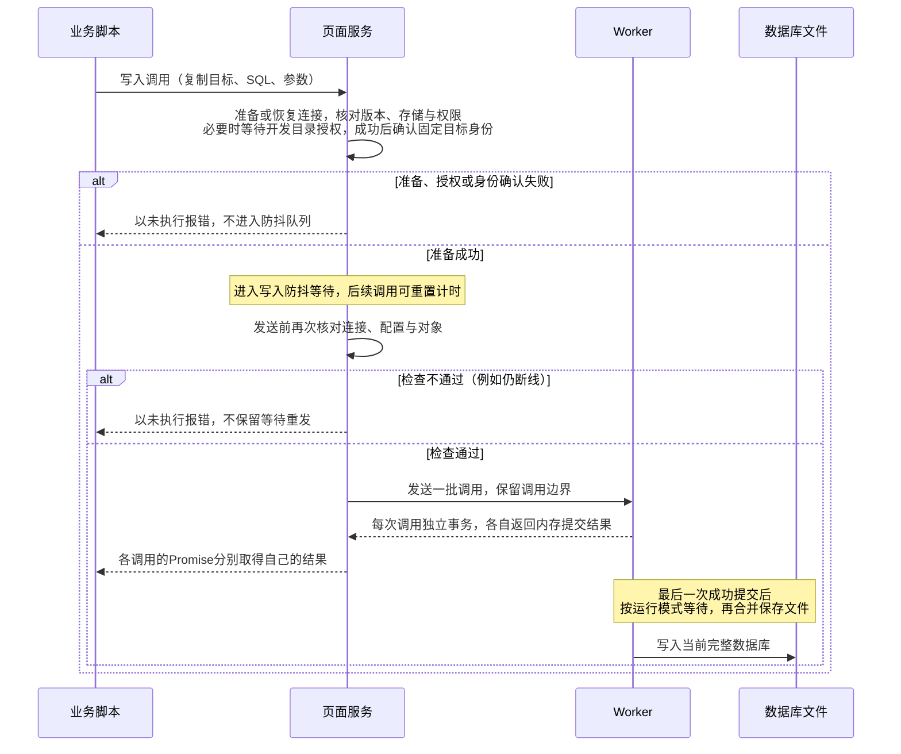
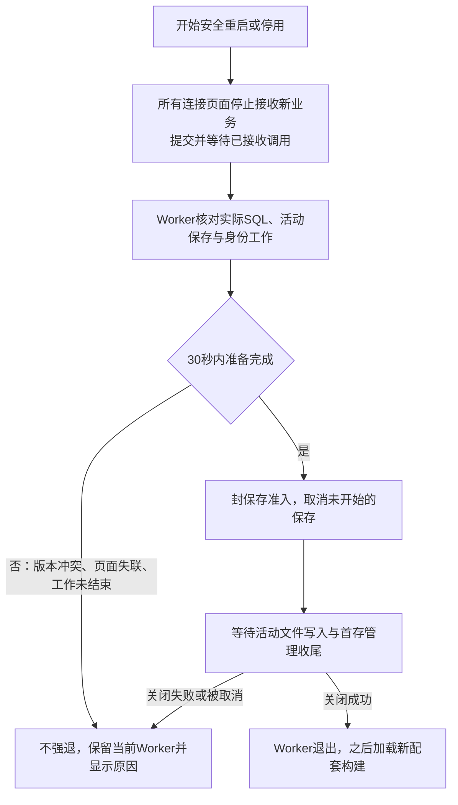

# 调用等待与恢复契约

本文说明等待、发送、断线和重启怎样影响业务调用。事务与文件保存见[数据库与保存契约](helper-sql.md)，实际开关与更新操作见[使用与维护指南](helper-usage.md)。

## 固定对象与请求内容

例如聊天 A 的写入正在等待授权，用户切到 B。原调用仍操作 A，SQL、参数和代理配置使用调用时副本；修改原参数不会改变这次调用。目录配置或原对象失效就报错，不把请求送到新对象或新目录。

同一页面共用服务与连接。重复加载扩展或卸载管理界面不另建队列、不关闭共享服务。调用结束释放请求内容；页面 Promise 已结束不证明 Worker 工作已取消，已接收 SQL、文件保存和身份工作仍按实际状态参与退出核对。

## 防抖等待与执行顺序

页面防抖的默认值和配置见[公共接口契约](helper-api.md#公开操作与防抖)。同目标后续防抖调用可重置计时，连续输入可能推迟发送；全部调用按序保留，两次加一都执行。到期发送的一批消息保留调用边界，每次分别提交内存事务和交付结果；一个 SQL 失败并回滚，不自动使其他独立调用失败。

图的读法：写入完成连接、授权和身份准备后才开始页面防抖；发送前只再核对当前条件，不在队列中等待重连或重发。文件保存的等待发生在 Worker 内，两种等待都不合并事务。

关闭防抖只影响后续调用，不提交此前待发送内容。query 不防抖，也不强制提交等待写入。“先应用 UI 修改，再处理 AI 结果”须先等相关写入 Promise 成功，再发 AI 命令；仅关闭防抖或改变调用先后不够，示例见[业务侧使用指南](helper-author-guide.md#ui-增量修改与-ai-结果的先后顺序)。跨调用依赖和是否接受基于旧输入的覆盖值由业务决定。

切换存储前，插件暂停本页面新调用，提交并等待已接收的直接与防抖调用结束，失败则暂不完成切换。尚在授权或配置确认的调用可等切换结束后核对原配置；其他页面未发送内容仍指向原目标。Worker 关闭旧实例前取消未开始后台保存并等活动写入与收尾，不强制保存全部内存修改、不转存新目录。意外关闭页面可能丢失未发送或未落盘修改，不靠卸载事件保证保存。

## 连接恢复与结果

两种入口共用版本核验、存储和身份恢复流程。SharedWorker 重新接入共享实例；普通 Worker 保留主页面持有的实例，只更换 MessageChannel 端口，不重新初始化数据库内核。普通断线、握手超时或存储失败都不自动创建第二个 Worker，也不先强制终止旧实例；无法恢复时明确交付失败，由用户处理后刷新。旧端口的迟到消息和错误不影响新连接。

公共调用开始时准备或恢复连接：核对版本、确认存储与权限、恢复已确认角色和聊天后才允许提交。握手成功只说明通信建立；恢复不写历史酒馆编号、不生成新身份或重建数据库。等待期间保留原快照，准备失败交付调用方。

写入进调度器后，发送前检查发现仍断线时，以未执行报错并释放该调用，不保留等待重发；防抖期间连接已恢复则照常发送。已经发送的 SQL 不自动重发，通信错误依据本次证据交付已知或未知结果。连接恢复、重新打开当前文件都不改变旧调用结果，也不能替业务补偿。初始调用遇到需要安全升级的旧 Worker 时按未执行返回服务忙；已接收工作继续完成。

普通 SQL 等实际结果，没有“30 秒未回复就断开全部连接”的超时。握手、恢复、授权和升级准备各有有限等待，恢复上限 30 秒，开发模式授权等待默认 120 秒。超时或重连不能证明先前写入没执行，也不能默认解决慢 SQL。授权等待的目标、取消及迟到结果规则见[公共接口](helper-api.md#未授权时的调用)。

每次调用通过自己的响应取得内存结果。后台保存失败独立显示在当前连接页面的诊断、管理区域与原生 toast，不改变原 Promise、不触发 SQL 重发。没有公共订阅、保存成功事件或每调用保存映射；业务主动 query，查看器打开或明确刷新时读取。页面诊断、授权和设置监听继续存在。错误分类及操作建议见[错误说明](helper-errors.md)。

## 等待工作结束与配套更新

安全重启和停用的步骤见下图。其中重启和停用会结束仍在授权等待的调用并按未执行交付，已开始的身份和数据库工作仍等待真实结果。

图的读法：只有全部已接收工作都有结果才会退出；页面准备完成不证明文件已落盘，退出也不强制保存全部修改。取消准备不取消已发送 SQL，已结束的未知调用及后台保存失败不永久阻止退出，实际活动工作仍须等完。最终退出等待活动保存时，若授权失效导致退出取消，且实例尚未关闭，则重新允许正常后台保存，并重新安排本次取消的保存；此前保存失败的内容不因此自动重试，已关闭实例也不重新开放。停用操作见[使用与维护指南](helper-usage.md#启用或关闭服务)。

每种构建用途使用其固定扩展目录，SharedWorker 入口为 `sqlite-worker.js`，普通 Worker 入口为 `sqlite-dedicated-worker.js`，均为 `classic` 类型、名称 `st-sqlite-helper`，地址不随 buildId 改变。两者复用上述准备、排空和关闭流程，不另开第二 Worker 升级同一目录。普通 Worker 只有一个参与页面，只有收到当前退出操作的 `phase: 'exit'` 后才释放旧实例；升级时再创建新实例，停用后不自动启动。准备完成、超时或页面请求已结束，都不能代替关闭成功确认。测试版、开发版与正式版切换时禁用其他版本并刷新相关页面，操作见[使用与维护指南](helper-usage.md#安装与更新)。完整构建共用 buildId，协议独立核验；API 不兼容明确拒绝。Worker 更新不替换已加载页面实现，配套页面仍须刷新。同一 buildId 的自动升级只尝试一次，失败按明确操作处理。

旧 Worker 执行它加载的退出规则，更新资源不能消除旧未确认改名任务的限制。受阻时结束连接旧实例的会话，确认旧实例结束后加载新配套构建，不引入过渡 Worker 或另一存储后端。

## 使用范围

SharedWorker 的多页面共享只覆盖同一浏览器配置和同一来源（协议、主机、端口）。普通 Worker 只支持一个酒馆主页面；切换运行模式前须关闭其他同源酒馆页面，普通 Worker 模式下不再打开第二个页面。不同来源、浏览器或配置也不能并发写同一授权目录，不支持外部程序同时改库。全部页面关闭后不承诺 SharedWorker 继续保存，普通 Worker 随所属页面结束。刷新不额外保存，新实例读取当前文件，不恢复旧 SQL、Promise 或执行凭据。
