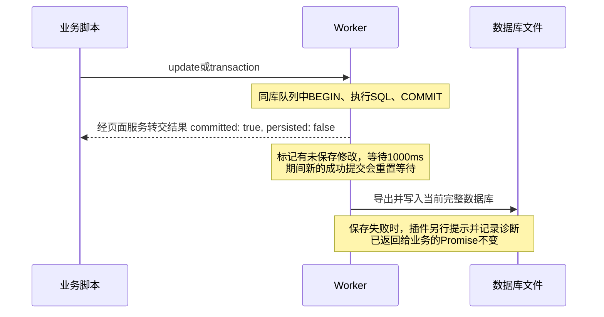

# 数据库与保存契约

一次调用只操作一个固定数据库。每次业务写入独立提交内存事务，成功返回 `{ committed: true, persisted: false }`，随即可以查询或继续修改当前内存数据。文件由后台在最后一次成功提交后等待 1000ms 合并保存；业务 Promise 不证明文件已保存，`persisted: false` 也不能用来断言文件一定还没写入。完整调用示例见[业务侧使用指南](helper-author-guide.md)。

## 数据范围和文件

| 代理 | 范围 | 文件 |
| --- | --- | --- |
| root | 当前存储模式的全局数据 | `global.sqlite` |
| char | 同一角色共享数据 | `characters/<char_dbid>/char.sqlite` |
| chat | 一个聊天的数据 | `characters/<char_dbid>/chats/<chat_dbid>.sqlite` |

`char_dbid` 和 `chat_dbid` 是酒馆保存的数据库编号，不是楼层编号或分支编号。编号确认不等于文件创建；查询不创建角色和聊天库，首次写入才建库。已创建文件缺失、无法打开或初始化状态不清楚时拒绝，不用空文件替代。身份无法确认、文件缺失与读取失败按[错误说明](helper-errors.md)分别交付，不将这些情况报告为首次空库。

一个目录用于一个酒馆实例和账号。重新选同一目录复用其身份，切换其他目录不自动迁移数据。句柄保存在浏览器 IndexedDB 中，权限仍要核对；路径文字不能代替授权。换目录前等待已接收工作，旧代理之后报目录配置失效，不转写新目录。

游玩模式在 OPFS 专用 `st-sqlite-helper` 子目录采用同一文件布局，无需用户目录授权。切换模式保留各自数据和稳定空间身份，不自动迁移；已有角色和聊天编号在新空间首次查询不建业务库，首次写入可创建该空间文件，已创建文件缺失仍拒绝重建。开发文件的手动和自动重新加载见[使用与维护指南](helper-usage.md#外部修改后重新加载)。

## SQL 方法

| 方法 | 允许的 SQL | 说明与结果 |
| --- | --- | --- |
| query | 一条 SELECT，可绑定参数 | 返回列名与行数组 |
| update | 一条 INSERT／UPDATE／DELETE／REPLACE，可绑定参数 | 泛指数据写入，不限于 SQL UPDATE。成功返回 `{ committed: true, persisted: false }` |
| exec | 一条或多条 CREATE／ALTER／DROP，直接传 SQL 字符串，不收绑定参数 | 多条 DDL 保持顺序，整次调用一个事务，不逐条单独保存，后续出错则整批回滚。结果同 update |
| transaction | 命令数组，每条命令一条数据修改或 DDL，可各自绑定参数 | 不要求调用方声明命令类型。全部命令共同提交或回滚，结果同 update |
| runSql | SQL 字符串或字符串数组，不做前缀和单语句限制 | 可信脚本的显式例外，见 [runSql](#runsql)。结果同 update，不收集 SELECT 结果 |

- SQL 原生值为 null、有限数值、字符串及 Uint8Array。查询返回列名和这些值组成的行数组。
- 写入成功只证明当前内存事务提交，不返回操作 ID。
- 动态表名和列名不能用值绑定替代，由业务负责正确构造和引用。

完整方法签名和公共类型使用扩展包中的 `types/sqlite-helper.d.ts`。

### 参数绑定

query、update 以及 transaction 内的每条命令共用同一套绑定规则。

| 形式 | 写法 |
| --- | --- |
| 位置参数 | 数组，通常配合 `?` 占位符 |
| 命名参数 | 普通对象，支持 `:name`、`@name`、`$name`。对象键必须包含与 SQL 一致的前缀，例如 `{ ':id': itemId }` |

- 不自动给键补前缀，也不把绑定值拼接进 SQL。
- 同一条命令选择一种绑定形式，不混用位置与命名参数；不同命令可以各自选择。
- 没有参数时省略 binds。SQL NULL 用数组元素或对象属性值 null 表达，布尔列直接写 0 或 1。

### JSON 与二进制参数

自动 JSON 转换是输入便利功能，不改变 SQLite 的存储类型。

| 绑定值 | 处理 |
| --- | --- |
| 最外层 binds 数组或对象 | 仍是参数容器，不对整个容器 stringify，逐个处理其中的绑定值 |
| JSON 数组或普通对象 | 自动 JSON.stringify() 为字符串，再按 TEXT 绑定。嵌套 JSON 可包含 boolean 和 null |
| 顶层 boolean | 暂不扩展，需要布尔列时显式使用 0 或 1 |
| null、字符串、有限数值 | 保持原义。已是 JSON 字符串的值不再次 stringify |
| Uint8Array | 作为独立绑定值仍是 BLOB，不转 JSON |

转换前先递归校验 JSON 值：

- 拒绝循环引用、undefined、函数、symbol、bigint、非有限数值及数组空位，避免 stringify 静默丢字段或替换为 null。
- 不隐式转换 Date、Map、Set、类实例或嵌套二进制对象，不依赖自定义 toJSON；这些值需业务先转为约定的 JSON 值。

调用时即完成校验，并复制独立 Uint8Array 的字节，固定本次命令内容：

- 防抖等待期间修改原数组、对象或二进制缓冲区，不改变待提交的操作。
- 校验失败时拒绝整次调用，不部分入队。
- 查询结果里的 JSON TEXT 返回字符串，不自动 JSON.parse()，由业务根据字段语义决定是否解析。

| 写法 | 含义 |
| --- | --- |
| `binds: [1, 2]` | 两个位置参数 |
| `binds: [[1, 2]]` | 一个位置参数，其值序列化为字符串 `"[1,2]"` |
| `{ ':tags': ['药品', '消耗品'] }` | 一个名为 `:tags` 的 JSON TEXT 参数 |

### 允许的 SQL 范围

普通方法按首关键字做简单检查：

1. 略过头部空白、`--` 行注释和 `/* … */` 块注释。
2. 读取第一个完整关键字，大小写无关地匹配白名单；SELECTxxx 等名称不能匹配为 SELECT。
3. 空输入、未闭合头部块注释及未列入白名单的前缀明确拒绝。

单语句规则：

- query、update 和 transaction 的每条命令只接受一条语句，出现额外语句明确报错。
- exec 允许多条 DDL，逐条做同样的前缀检查，完整执行后才提交和保存。
- 语句边界由 SQLite 识别，不按分号切割；字符串、注释和触发器正文里的分号不影响结果。参数中的分号保持数据含义。

普通方法不开放以下内容：

| 内容 | 状态 |
| --- | --- |
| 调用方 PRAGMA | 暂不开放 |
| BEGIN／COMMIT／ROLLBACK／SAVEPOINT／RELEASE 等事务控制 | 暂不开放 |
| ATTACH／DETACH 及其他非白名单前缀 | 暂不开放 |
| WITH 前缀 | 暂不开放，不分析其后续属于查询还是写入 |

以 SELECT 开头的 JOIN、子查询、聚合、函数，以及 `main.表名` 和正常引用方式，交给 SQLite 处理，不做细粒度限制。

### runSql

`runSql(sql: string | string[])` 是可信业务直接执行入口，是上述普通方法 SQL 限制的显式例外，root、char、chat 三类代理都提供。

| 项目 | 规则 |
| --- | --- |
| 不做的检查 | SQL 前缀白名单、方法匹配、单语句限制、内容审查 |
| 输入形式 | 字符串内可有多条语句，数组按顺序执行 |
| 语法与执行错误 | 由 SQLite 负责 |
| 仍复用 | 固定目标与配置编号、按库队列、服务事务、保存和实例恢复路径 |
| 返回 | `{ committed: true, persisted: false }`，不收集 SELECT 结果；需要查询结果时用 query |

### DDL、约束与业务责任

- CREATE／ALTER／DROP 不细分对象类型。表、索引、视图、触发器及虚拟表由业务按当前 sql.js 和 SQLite 的实际能力使用，SQL 错误如实返回。服务不审查函数、嵌套引用、视图或触发器正文。
- 唯一键、外键、非空和 CHECK 等约束由业务表设计承担。通用接口不强制版本号或影响行数断言，普通更新零行本身不算失败。
- 业务不得修改、删除或通过间接行为破坏 `__stsh_` 内部对象，不得自行改变服务管理的事务与连接配置。这是可信业务的使用约定，不是对恶意 SQL 的隔离保证。
- 业务负责 SQL 意图，服务保留目标绑定、有序执行、整批事务和准确的执行结果。

### 不提供的接口

公共代理不暴露数据库实例、prepare 或 Statement 缓存，不接受 `transaction(db => ...)` 回调，也不提供跨多次调用的 `begin()`、`commit()`、`rollback()` 句柄。内部 `checked-transaction` 供内嵌系统在同一事务中做条件检查，公共代理不提供。业务等待自己的写入 Promise 后可 query 当前内存结果，但不能据此认定文件已保存。

## 事务和保存

例如 A 加一、B 违反唯一键、C 加一是三次调用：A 提交，B 回滚，C 仍可执行，后台文件最终只包含 A 和 C。把 A、B、C 放进一次 `transaction` 时，B 失败会使整个事务回滚。页面防抖减少消息次数，数据库后台防抖合并文件保存，两者都不合并事务。更新零行本身不算失败。

图的读法：业务 Promise 在内存提交后就返回，文件保存在其后独立发生；同库的其他 SQL 不会插入导出和文件写入之间。

内部管理事务仍等待文件保存，返回 `{ persisted: true }`。它可同时保存该库此前的业务内容，但不给旧调用补发保存成功结果。

| 情况 | 结果与影响 |
| --- | --- |
| SQL 失败且回滚成功 | 本次未提交；已有实例可继续用，首批失败的临时实例丢弃 |
| 回滚也失败 | 停用实例，保留两个错误；从文件恢复不重做 SQL |
| 后台导出或恢复配置失败 | 单独通知未保存；若实例不可用则停用 |
| 后台文件写入失败 | 单独通知文件结果未知；可用内存及未保存修改保留 |
| 文件已保存但文件信息或登记失败 | 单独通知已知文件已保存和失败阶段 |
| 重新加载文件成功 | 恢复当前数据可用性，不改判旧调用成功 |

业务 SQL 开始前的管理建表、身份登记及 root 空文件创建失败时，本次业务报未执行。首次目标 COMMIT 已返回后，后台才保存 root creating、目标文件和 root ready，任一后台失败都不改变原 Promise。通知说明失败阶段、文件结果和内存是否可用，不映射到某笔业务调用，也不建议重新提交原 SQL。失败不自动重试，后续新的成功修改可以安排自己的正常保存。公共错误字段及后续处理见[错误说明](helper-errors.md)。

后台保存只在最后一次成功提交后静默 1000ms 才开始，没有最长等待上限。例如每隔半秒连续写入，文件会一直推迟到写入停顿后才保存；这期间关闭页面、停用服务或重载文件，未保存的修改可能丢失。服务不提供公共强制保存、退出前补存或保存成功通知。

数据库文件保存与酒馆聊天文件保存是两条独立流程，不构成共同事务。例如业务先写入数据库、再让酒馆保存消息或楼层信息，两边可能一边已保存、一边尚未保存；需要两边对应的业务自行设计核对或容错方式，服务不补偿、不重放。

普通查询使用 Worker 当前实例，不在每次读写前重新加载文件。首次内存提交后、文件创建前也可以读取和继续修改；已有 ready 文件丢失仍拒绝。关闭、切换和删除取消尚未开始的后台保存，等待活动文件写入与管理收尾结束，不强制保存所有修改。手动重载从已有文件替换实例，未保存内容可丢失，首存前没有文件时明确拒绝并保留可用内存。

## 重复调用和使用限制

不保存每次 SQL 的操作 ID、指纹或去重记录，再次提交相同 SQL 会再次执行。通信 ID 只用于对应回复，不证明重复写入安全。需要可重复操作时由业务使用唯一键和条件更新；已发送 SQL 通信中断后不自动重发，见[调用等待与恢复契约](helper-recovery.md)。

插件内部对象使用保留前缀 `__stsh_`，业务不得创建、修改或间接破坏这些对象。全局管理记录和目标库身份项由插件维护，业务不得直接操作；数据位置与维护限制见[使用与维护指南](helper-usage.md#文件升级与备份)。这是可信业务约定，不是恶意 SQL 隔离。

root 保存期间可让其他库的新请求等配置检查，这是已接受行为，不承诺各库完全独立的延迟。约 10MB、每秒一次写入是设计预期，尚无性能或长期内存保证，不能将这些设计预期当作已验证的支持上限。
